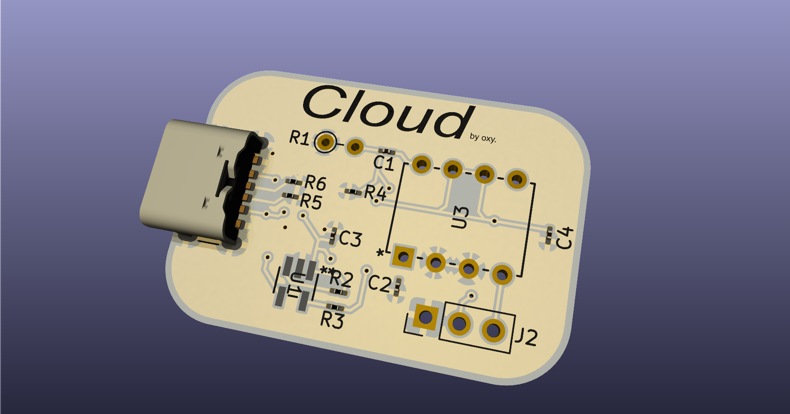
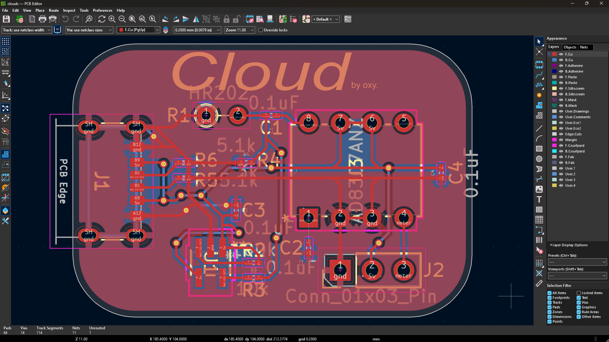
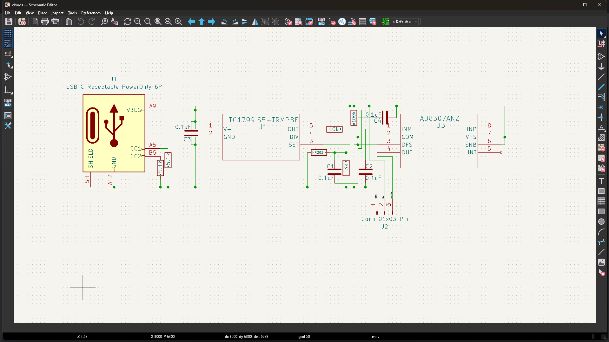
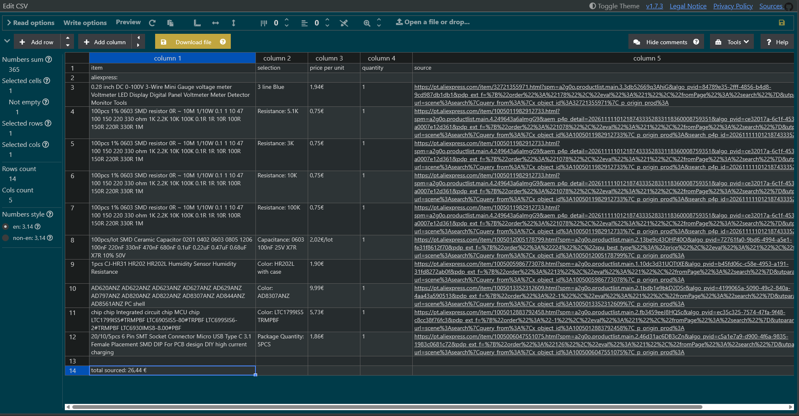

# cloud
a small fully hardware (as in no firmware needs to be flashed) humidity sensor, sporting a HR202L resistive humidity sensor and a log amp to make it readable along side a dc to ac configurable generator to power the humidity sensor.

everything works on this humidity sensing like device, idk what the proper name is ill just say sensor, everything works on this sensor through the HR202L, but it cant run on DC, it will die because of how resistive humidity sensors work, but it is very accurate from what i know and very nice as a relative humidity sensor, anyways so this full sensor board needs abt 5 diff types of resistors, some to cut down the voltage to the HR202L and then another to set the frequency of the LTC1799 which is providing the AC for the HR202L, then we have a AD8307ANZ to turn the HR202L resistance value into something more usable and then from all of that is given a signal pin for a voltmeter, you can see the pin holes by J2 on the render image at the top.

anyways so other than that for the tools i used, i used kicad and then for like the start i used tinkercad's circuit thing when i was still thinking of using a 555 and trying to figure out how it worked anyways so also credit to google ai at the start tho all it was was the ai overview and search thing, and it lowk sucked and was just telling me random shit, anyways so after i switched to deepseek everything was good and it helped me with component selection and also the schematics, tho i did all the pcb wiring myself and i always do as its calming for me, anyways heres all the images <3

the main goal of this project was to ship for hackclub embassy, also if i build one its lowk just gonna be for my 3d printers diy drybox so i can check humidity levels.

made with love.
by oxy <3

